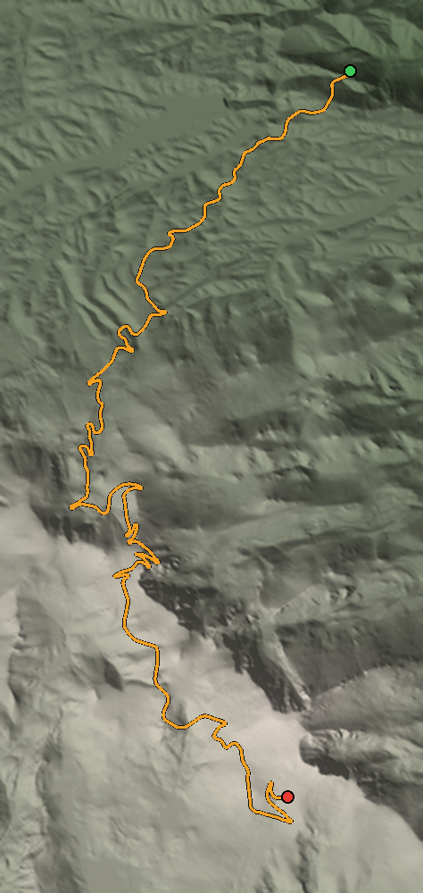

# Course data report

Fetched 2026-11-12 15:05 UTC.

| | From the data | Published |
|---|---|---|
| Length | 12.42 mi | 12.42 mi |
| Start elevation | 8,595 ft | 9,390 ft |
| Finish elevation | 12,892 ft | 14,115 ft (summit) |
| Climb | 4,297 ft | 4,725 ft |
| Corners (rough count) | 90 | 156 |

- Road: OpenStreetMap, 2903 points (© OpenStreetMap contributors, ODbL)
- Terrain: USGS 3D Elevation Program (3DEP), 1/3 arc-second, via the National Map ImageServer
- Grid saved for the game: 269 x 567 cells

